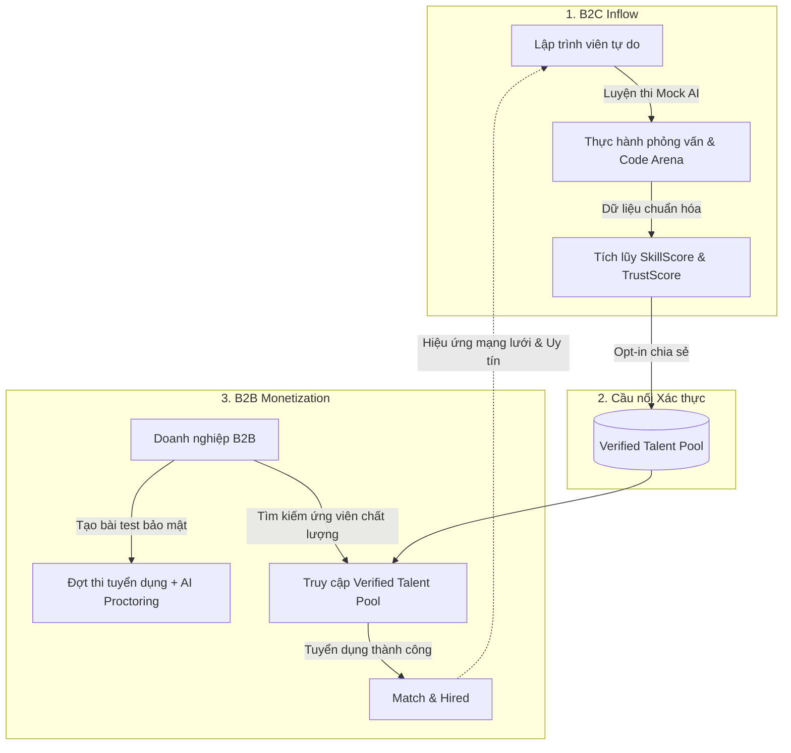
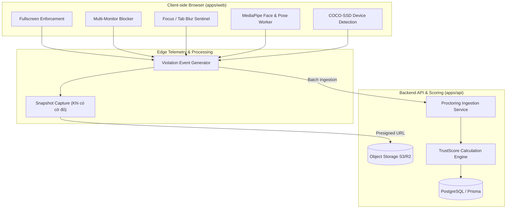
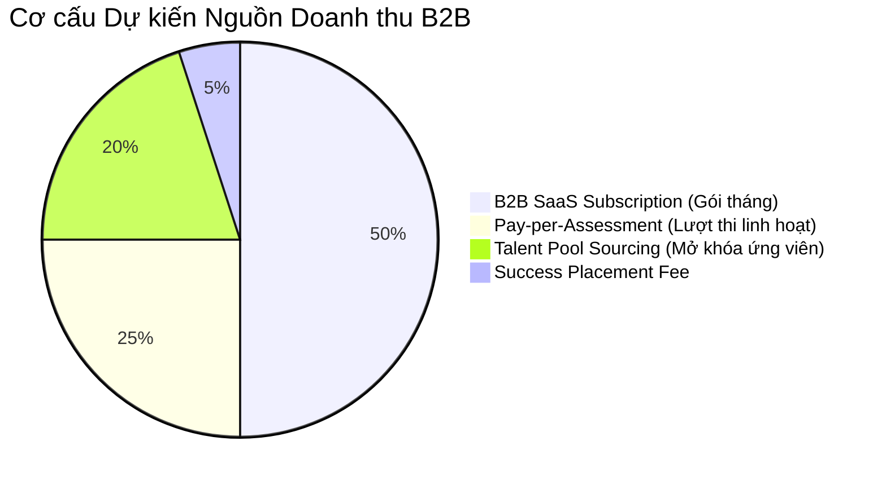

# PRD: NỀN TẢNG THI TUYỂN B2B (AI PROCTORING) & CHỢ NHÂN TÀI ĐÃ XÁC THỰC (VERIFIED TALENT POOL)

- **Mã tài liệu**: `PRD-B2B-PROCTORING-TALENT-POOL`
- **Phiên bản**: 1.0.0
- **Trạng thái**: Draft / Approved for Design
- **Tác giả**: Product Management Team
- **Liên quan đến**: `apps/api/src/modules/b2b`, `apps/api/src/modules/engineering-arena`, `apps/web`

---

## 1. TỔNG QUAN CHIẾN LƯỢC & TẦM NHÌN SẢN PHẨM

### 1.1. Tuyên ngôn Sứ mệnh

Biến nền tảng luyện thi cá nhân (B2C) thành một **Hệ sinh thái Tuyển dụng Kỹ thuật Toàn diện (B2B2C Talent Ecosystem)**:

- **Phía Doanh nghiệp (B2B)**: Nền tảng tổ chức thi tuyển online với hệ thống giám thị thông minh (Intelligent Proctoring) ngăn chặn gian lận tuyệt đối, giảm 80% thời gian screening kỹ thuật.
- **Phía Ứng viên (B2C)**: Môi trường luyện phỏng vấn, chứng thực năng lực thực chiến bằng điểm số khách quan và tự động kết nối với các cơ hội việc làm chất lượng cao mà không cần rải CV.

### 1.2. Mô hình Bánh đà Tăng trưởng (Product Flywheel)



---

## 2. BÀI TOÁN THỊ TRƯỜNG & NỖI ĐAU NGƯỜI DÙNG (PROBLEM STATEMENT)

| Đối tượng              | Nỗi đau cốt lõi (Pain Points)                                                                                                                                                                                                                                                                         | Hậu quả thực tế                                                                                                                  | Giải pháp của hệ thống                                                                                                                                                                |
| :--------------------- | :---------------------------------------------------------------------------------------------------------------------------------------------------------------------------------------------------------------------------------------------------------------------------------------------------- | :------------------------------------------------------------------------------------------------------------------------------- | :------------------------------------------------------------------------------------------------------------------------------------------------------------------------------------ |
| **Doanh nghiệp (B2B)** | **1. Gian lận bài test tràn lan**:<br>Ứng viên dùng ChatGPT, màn hình phụ, nhờ người giải bài.<br>**2. Chi phí sàng lọc đắt đỏ**:<br>Tốn 3-5 giờ phỏng vấn của Tech Lead cho 1 ứng viên.<br>**3. Thiếu ứng viên chất lượng**:<br>Khó tiếp cận nhân tài passive (đang có việc, không chủ động nộp CV). | - Tuyển nhầm người, tốn chi phí thử việc.<br>- Lãng phí băng thông kỹ thuật nội bộ.<br>- Phải trả phí Headhunt 15-20% lương năm. | - Bộ công cụ giám thị thông minh 3 lớp (Browser, Edge AI, Keystroke).<br>- Tự động chấm điểm khách quan qua Rubrics.<br>- Tiếp cận ngay nhóm ứng viên Top 10% đã qua kiểm chứng.      |
| **Ứng viên (B2C)**     | **1. Rải CV vô vọng (CV Blackhole)**:<br>Nộp hàng chục công ty nhưng bị loại bởi ATS lọc từ khóa.<br>**2. Mệt mỏi vì làm lại test**:<br>Mỗi công ty bắt làm 1 bài take-home 4-8 tiếng tương tự nhau.<br>**3. Thiếu thước đo minh bạch**:<br>Không biết mình đang ở đâu so với thị trường.             | - Mất động lực tìm việc.<br>- Tốn nhiều thời gian vô bổ.<br>- Không chứng minh được năng lực thực nếu thiếu bằng cấp danh tiếng. | - Luyện 1 lần, điểm số và bài test được chứng thực trên toàn hệ thống.<br>- Doanh nghiệp chủ động liên hệ mời phỏng vấn.<br>- Có báo cáo chi tiết điểm mạnh/yếu để nâng cấp bản thân. |

---

## 3. CHÂN DUNG NGƯỜI DÙNG & HÀNH TRÌNH TRẢI NGHIỆM (PERSONAS & USER JOURNEYS)

### 3.1. Persona 1: Tech Recruiter / Hiring Lead (B2B) - "Hoàng"

- **Đặc điểm**: Cần tuyển 5 Backend Node.js cho đợt tuyển dụng quý 4. Đang nhận 150 hồ sơ.
- **Hành trình**:
  1. Tạo chiến dịch tuyển dụng `Node.js Mid-Senior Q4`.
  2. Chọn bộ đề chuẩn từ Question Bank hoặc tạo đề riêng, thiết lập thời gian làm bài 60 phút, kích hoạt chế độ **Strict Proctoring**.
  3. Gửi link bài thi qua email danh sách ứng viên (hệ thống sinh link tokenized dùng 1 lần).
  4. Hệ thống tự động chấm điểm, lọc ra bảng xếp hạng kèm chỉ số `TrustScore`.
  5. Đối với các bài làm điểm cao, Hoàng kiểm tra **Proctoring Flag Timeline** (chỉ mất 2 phút xem lại các đoạn bị cờ vàng/đỏ thay vì xem toàn bộ video 60 phút).
  6. Với các vị trí còn thiếu, Hoàng mở tab **Verified Talent Pool**, lọc ứng viên có kỹ năng Node.js > 8.0, bấm "Mời kết nối trực tiếp".

### 3.2. Persona 2: Candidate Tham gia Đợt thi Tuyển dụng (B2B Test-Taker) - "Minh"

- **Đặc điểm**: Ứng viên nhận được email mời làm bài kiểm tra từ doanh nghiệp.
- **Hành trình**:
  1. Nhấp vào link bài thi, hệ thống hiển thị màn hình **Pre-flight System Check**:
     - Kiểm tra quyền truy cập Camera & Micro.
     - Kiểm tra số lượng màn hình (bắt buộc ngắt màn hình phụ).
     - Bật chế độ Fullscreen bắt buộc.
     - Đọc và đồng ý với điều khoản giám sát minh bạch.
  2. Bắt đầu làm bài trong môi trường Code Arena / Multiple Choice.
  3. Nếu vô tình chuyển tab hoặc có người bước vào khung hình, hệ thống hiện cảnh báo nhẹ màu vàng để nhắc nhở điều chỉnh.
  4. Nộp bài thành công, nhận biên lai xác nhận nộp bài (submission hash).

### 3.3. Persona 3: Lập trình viên Chủ động Ôn luyện (B2C Dev) - "Trang"

- **Đặc điểm**: Đang làm Junior muốn nhảy việc lên Mid-level.
- **Hành trình**:
  1. Tự luyện tập các buổi phỏng vấn AI và giải đề thi trong Engineering Arena.
  2. Đạt điểm số `ReadinessScore = 82/100` và `SkillScore = 8.5` mảng Frontend React.
  3. Bật tính năng: _"Open to Opportunities"_ trong trang cá nhân. Chọn cấu hình:
     - Chế độ ẩn danh (Che tên thật, chỉ hiển thị ID mã hóa và điểm số).
     - Mức lương mong muốn: từ \$1,200/tháng, hình thức Remote/Hybrid.
  4. Nhận email thông báo có 2 công ty công nghệ lớn quan tâm và gửi lời mời phỏng vấn trực tiếp. Trang bấm "Chấp nhận" để mở khóa thông tin liên hệ.

---

## 4. YÊU CẦU CHỨC NĂNG (FUNCTIONAL REQUIREMENTS)

### EPIC 1: HỆ THỐNG GIÁM THỊ THÔNG MINH (INTELLIGENT PROCTORING ENGINE)



#### Phân hệ 1: Bảo vệ Môi trường Trình duyệt (Browser Sandbox)

- **FR-PROC-001 (Fullscreen Enforcement)**:
  - Bắt buộc toàn màn hình trước khi bắt đầu làm bài.
  - Thoát Fullscreen: Hiển thị modal khóa bài thi kèm đếm ngược 10 giây để quay lại. Ghi nhận sự kiện `VIOLATION_EXIT_FULLSCREEN`.
- **FR-PROC-002 (Multi-Monitor Detection)**:
  - Sử dụng Screen Details API (`window.getScreenDetails()`) hoặc `window.screen.isExtended`.
  - Nếu kết nối > 1 màn hình: Chặn không cho bắt đầu làm bài, yêu cầu ngắt kết nối màn hình ngoài.
- **FR-PROC-003 (Tab Switch & Focus Loss Tracking)**:
  - Lắng nghe sự kiện `visibilitychange` và `window.onblur`.
  - Ghi nhận `VIOLATION_TAB_SWITCH` hoặc `VIOLATION_WINDOW_BLUR` kèm thời lượng rời màn hình.
- **FR-PROC-004 (Input & Clipboard Restriction)**:
  - Chặn chuột phải (`contextmenu`), chặn các phím tắt `F12`, `Ctrl+Shift+I`, `Ctrl+U`, `Alt+Tab`.
  - Vô hiệu hóa thao tác Paste từ nguồn bên ngoài (trừ code do đề bài cung cấp).

#### Phân hệ 2: Thị giác Máy tính Biên (Edge Computer Vision Sentinel)

_Quy chuẩn kỹ thuật: Chạy 100% bằng Web Worker phía client (MediaPipe / TensorFlow.js) với tần suất 2 FPS để tiết kiệm băng thông và tôn trọng quyền riêng tư._

- **FR-PROC-005 (Face Presence & Absence Tracking)**:
  - Dùng mô hình MediaPipe Face Detection.
  - Ghi nhận `VIOLATION_NO_FACE` nếu không thấy khuôn mặt liên tục > 8 giây.
  - Ghi nhận `VIOLATION_MULTIPLE_FACES` nếu phát hiện >= 2 khuôn mặt liên tục > 3 giây.
- **FR-PROC-006 (Gaze Tracking & Looking Away)**:
  - Ước tính góc quay đầu (Pitch, Yaw, Roll).
  - Ghi nhận `VIOLATION_LOOKING_AWAY` nếu góc quay lệch khỏi màn hình > 35 độ liên tục > 12 giây.
- **FR-PROC-007 (Secondary Device & Object Detection)**:
  - Dùng mô hình COCO-SSD (nhận diện các lớp: `cell phone`, `laptop`, `book`).
  - Ghi nhận `VIOLATION_DEVICE_DETECTED` khi phát hiện điện thoại với độ tin cậy > 0.65.
- **FR-PROC-008 (Snapshot on Flag)**:
  - Khi phát sinh cờ vi phạm mức Nghiêm trọng (Điện thoại, Rời ghế, Người thứ 2), trích xuất 1 ảnh khung hình webcam (640x480) và upload qua Presigned URL lên Cloud Storage làm bằng chứng đối soát.

#### Phân hệ 3: Đánh giá Độ tin cậy (TrustScore Calculation)

- **FR-PROC-009 (Dynamic TrustScore Engine)**:
  - Điểm khởi tạo: 100 điểm.
  - Công thức khấu trừ:
    $$TrustScore = 100 - \sum (Count_i \times Weight_i)$$
  - Trọng số vi phạm ($Weight_i$):
    - Rời khỏi toàn màn hình / Chuyển tab: 5 điểm/lần.
    - Không có mặt trong khung hình (> 8s): 15 điểm/lần.
    - Xuất hiện điện thoại / thiết bị di động: 25 điểm/lần.
    - Xuất hiện người thứ hai: 20 điểm/lần.
    - Nhìn lệch góc kéo dài: 5 điểm/lần.
    - Thao tác gõ phím siêu tốc bất thường (Burst paste): 15 điểm/lần.
  - Ngưỡng phân loại:
    - `85 - 100`: **Verified Honest** (Độ tin cậy cao).
    - `60 - 84`: **Needs Review** (Có dấu hiệu bất thường, cần nhà tuyển dụng xem bằng chứng).
    - `< 60`: **High Fraud Risk** (Nguy cơ gian lận cao, tự động cảnh báo từ chối kết quả).

---

### EPIC 2: TỔ CHỨC ĐÁNH GIÁ DOANH NGHIỆP (B2B ASSESSMENT SUITE)

- **FR-ASSESS-001 (Campaign Lifecycle Management)**:
  - Tenant Admin / Interviewer tạo đợt thi (Campaign): Tên vị trí, Ngày bắt đầu/kết thúc, Thời lượng làm bài, Ngưỡng điểm đạt (Passing score).
  - Chọn định dạng bài test: Code thực chiến (Engineering Arena), Phỏng vấn AI đàm thoại (AI Voice Interview), hoặc Bài trắc nghiệm kiến thức.
- **FR-ASSESS-002 (Candidate Invitation & Identity Pre-flight)**:
  - Gửi lời mời hàng loạt bằng danh sách email.
  - Sinh đường dẫn làm bài an toàn kèm single-use HMAC token.
  - Chụp ảnh chân dung mẫu (Baseline Face Photo) trước khi làm bài để so sánh đối chiếu trong suốt bài thi.
- **FR-ASSESS-003 (Auditor Review Dashboard & Flag Replay)**:
  - Hiển thị danh sách ứng viên sắp xếp theo Điểm kỹ thuật và `TrustScore`.
  - Thanh timeline vi phạm đồng bộ: Nhấp vào từng điểm cờ đỏ để xem lại ảnh chụp bằng chứng vi phạm và đoạn log tương ứng mà không cần xem toàn bộ bài làm.

---

### EPIC 3: CHỢ ỨNG VIÊN ĐÃ XÁC THỰC (VERIFIED TALENT POOL & MATCHMAKING)

- **FR-TALENT-001 (Candidate Talent Profile Opt-in & Privacy Controls)**:
  - Ứng viên B2C đạt chuẩn (`ReadinessScore >= 70`) có quyền bật tính năng _"Chia sẻ hồ sơ tới Doanh nghiệp"_.
  - Quyền riêng tư linh hoạt:
    - Chế độ Ẩn danh (Anonymized Mode): Ẩn Họ tên, Email, Ảnh cá nhân, Công ty hiện tại; chỉ hiện ID, Biểu đồ kỹ năng (Skill Graph), Điểm số các bài test, Kinh nghiệm số năm.
    - Chế độ Công khai (Public Mode): Hiển thị đầy đủ thông tin hồ sơ và link GitHub/LinkedIn.
  - Thiết lập kỳ vọng: Mức lương tối thiểu mong muốn, Địa điểm làm việc, Chế độ làm việc (Remote / Hybrid / On-site).
- **FR-TALENT-002 (AI Matchmaking Engine)**:
  - Doanh nghiệp mô tả yêu cầu vị trí hoặc chọn Role Blueprint.
  - Thuật toán tính chỉ số Match Index ($Score_{match} \in [0, 100]$):
    $$Score_{match} = 0.35 \cdot SkillFit + 0.30 \cdot ArenaCodeScore + 0.20 \cdot InterviewScore + 0.15 \cdot TrustScore$$
  - Trả về danh sách Top ứng viên phù hợp nhất kèm lý do chi tiết (VD: _"Kỹ năng NestJS và PostgreSQL đạt 9.2/10, điểm tư duy kiến trúc đạt 8.5/10"_).
- **FR-TALENT-003 (Connection Request & Double Opt-in Workflow)**:
  - Doanh nghiệp nhấn "Gửi lời mời kết nối" (tốn quota kết nối của gói tài khoản).
  - Ứng viên nhận thông báo và có 72 giờ để "Chấp nhận" hoặc "Từ chối".
  - Khi ứng viên "Chấp nhận": Hệ thống mở khóa thông tin liên hệ và CV chi tiết cho doanh nghiệp.

---

## 5. YÊU CẦU PHI CHỨC NĂNG (NON-FUNCTIONAL REQUIREMENTS)

| Mã NFR           | Danh mục                                 | Yêu cầu kỹ thuật                                                                                                                                                                          |
| :--------------- | :--------------------------------------- | :---------------------------------------------------------------------------------------------------------------------------------------------------------------------------------------- |
| **NFR-PERF-001** | Hiệu năng Client                         | Các model AI thị giác máy tính chạy trong Web Worker không được chiếm quá 15% CPU và không gây giật lag (frame drop) trên trình soạn thảo code Monaco Editor.                             |
| **NFR-PERF-002** | Tần suất Telemetry                       | Dữ liệu giám thị được gửi lên server theo cơ chế batching mỗi 15 giây hoặc tức thì khi xuất hiện vi phạm mức `CRITICAL` để tiết kiệm băng thông mạng.                                     |
| **NFR-PRIV-001** | Quyền riêng tư & GDPR                    | Không truyền tải hoặc lưu trữ video stream liên tục lên server. Chỉ lưu ảnh tĩnh tại thời điểm vi phạm. Ảnh vi phạm được mã hóa AES-256 trên S3.                                          |
| **NFR-PRIV-002** | Tự động hủy dữ liệu (Data Retention)     | Toàn bộ ảnh chụp bằng chứng vi phạm và biometric snapshot phải được tự động xóa vĩnh viễn (Hard-delete) sau đúng 30 ngày kể từ ngày kết thúc bài thi.                                     |
| **NFR-SEC-001**  | Chống bypass bài thi                     | Token mời thi cử chỉ có hiệu lực cho 1 lượt làm bài (Single-use). Nếu phát hiện 2 phiên làm việc (Concurrent session) cùng token, phiên đầu tiên bị ngắt lập tức.                         |
| **NFR-SEC-002**  | Cách ly Đa khách hàng (Tenant Isolation) | Dữ liệu chiến dịch tuyển dụng, kết quả thi và thông tin ứng viên của từng tenant được bảo vệ bằng Row-Level Security (RLS), ngăn chặn tuyệt đối rò rỉ dữ liệu chéo giữa các doanh nghiệp. |

---

## 6. THIẾT KẾ CƠ SỞ DỮ LIỆU ĐỀ XUẤT (DATABASE SCHEMA)

Cần bổ sung các bảng sau vào [schema.prisma](file:///c:/Users/Duong%20Vinh/Project/ai-interview-practice/apps/api/prisma/schema.prisma):

```prisma
// 1. Quản lý Đợt thi Tuyển dụng của Doanh nghiệp
model AssessmentCampaign {
  id              String                  @id @default(uuid()) @db.Uuid
  tenantId        String                  @map("tenant_id") @db.Uuid
  title           String                  @db.VarChar(200)
  description     String?                 @db.Text
  targetRole      String                  @map("target_role") @db.VarChar(100)
  targetLevel     String                  @map("target_level") @db.VarChar(50)
  durationMinutes Int                     @default(60) @map("duration_minutes")
  passingScore    Decimal                 @default(70.0) @map("passing_score") @db.Decimal(5, 2)
  isProctored     Boolean                 @default(true) @map("is_proctored")
  strictMode      Boolean                 @default(false) @map("strict_mode")
  status          String                  @default("ACTIVE") @db.VarChar(50) // DRAFT, ACTIVE, CLOSED
  createdAt       DateTime                @default(now()) @map("created_at")
  updatedAt       DateTime                @updatedAt @map("updated_at")

  tenant          Tenant                  @relation(fields: [tenantId], references: [id], onDelete: Cascade)
  invitations     AssessmentInvitation[]

  @@index([tenantId, status])
  @@map("assessment_campaigns")
}

// 2. Lời mời và Phiên làm bài của Ứng viên
model AssessmentInvitation {
  id              String            @id @default(uuid()) @db.Uuid
  campaignId      String            @map("campaign_id") @db.Uuid
  candidateEmail  String            @map("candidate_email") @db.VarChar(255)
  candidateName   String?           @map("candidate_name") @db.VarChar(255)
  inviteToken     String            @unique @map("invite_token") @db.VarChar(255)
  status          String            @default("PENDING") @db.VarChar(50) // PENDING, STARTED, SUBMITTED, EXPIRED
  expiresAt       DateTime          @map("expires_at")
  submittedAt     DateTime?         @map("submitted_at")
  totalScore      Decimal?          @map("total_score") @db.Decimal(5, 2)
  passed          Boolean?
  createdAt       DateTime          @default(now()) @map("created_at")

  campaign        AssessmentCampaign @relation(fields: [campaignId], references: [id], onDelete: Cascade)
  proctoring      ProctoringSession?

  @@index([campaignId, candidateEmail])
  @@index([inviteToken])
  @@map("assessment_invitations")
}

// 3. Phiên Giám sát (Proctoring Session)
model ProctoringSession {
  id              String                @id @default(uuid()) @db.Uuid
  invitationId    String                @unique @map("invitation_id") @db.Uuid
  trustScore      Decimal               @default(100.0) @map("trust_score") @db.Decimal(5, 2)
  baselinePhotoUrl String?              @map("baseline_photo_url") @db.VarChar(500)
  totalViolations Int                   @default(0) @map("total_violations")
  status          String                @default("INITIALIZING") @db.VarChar(50) // INITIALIZING, ACTIVE, TERMINATED, COMPLETED
  startedAt       DateTime              @default(now()) @map("started_at")
  endedAt         DateTime?             @map("ended_at")

  invitation      AssessmentInvitation  @relation(fields: [invitationId], references: [id], onDelete: Cascade)
  violations      ProctoringViolation[]

  @@map("proctoring_sessions")
}

// 4. Chi tiết các Sự kiện Vi phạm
model ProctoringViolation {
  id              String            @id @default(uuid()) @db.Uuid
  sessionId       String            @map("session_id") @db.Uuid
  violationType   String            @map("violation_type") @db.VarChar(100) // NO_FACE, MULTIPLE_FACES, DEVICE_DETECTED, EXIT_FULLSCREEN, TAB_SWITCH
  severity        String            @db.VarChar(50) // LOW, MEDIUM, CRITICAL
  penaltyPoints   Decimal           @map("penalty_points") @db.Decimal(5, 2)
  occurredAt      DateTime          @default(now()) @map("occurred_at")
  durationSeconds Int               @default(0) @map("duration_seconds")
  snapshotUrl     String?           @map("snapshot_url") @db.VarChar(500)
  metadata        Json?             @db.JsonB

  session         ProctoringSession @relation(fields: [sessionId], references: [id], onDelete: Cascade)

  @@index([sessionId, occurredAt])
  @@map("proctoring_violations")
}

// 5. Cấu hình Tham gia Chợ Ứng viên (Talent Pool)
model TalentPoolProfile {
  id              String    @id @default(uuid()) @db.Uuid
  userId          String    @unique @map("user_id") @db.Uuid
  isOpenToWork    Boolean   @default(false) @map("is_open_to_work")
  isAnonymous     Boolean   @default(true) @map("is_anonymous")
  headline        String?   @db.VarChar(200)
  minSalary       Decimal?  @map("min_salary") @db.Decimal(10, 2)
  currency        String    @default("USD") @db.VarChar(10)
  workPreference  String    @default("REMOTE") @map("work_preference") @db.VarChar(50) // REMOTE, HYBRID, ONSITE
  verifiedScore   Decimal   @default(0.0) @map("verified_score") @db.Decimal(5, 2)
  lastActiveAt    DateTime  @default(now()) @map("last_active_at")
  createdAt       DateTime  @default(now()) @map("created_at")
  updatedAt       DateTime  @updatedAt @map("updated_at")

  user            User      @relation(fields: [userId], references: [id], onDelete: Cascade)

  @@index([isOpenToWork, verifiedScore])
  @@map("talent_pool_profiles")
}
```

---

## 7. MÔ HÌNH KINH DOANH & ĐỊNH GIÁ (MONETIZATION STRATEGY)



1. **Gói Pay-as-you-go (Cho công ty tuyển dụng ít)**:
   - \$3.00 - \$5.00 / 1 lượt ứng viên hoàn thành bài thi có giám thị AI và báo cáo gian lận.
2. **Gói Thuê bao Tháng (B2B SaaS Tier)**:
   - **Growth Plan (\$299/tháng)**: Tối đa 100 lượt thi/tháng, 3 bài test tùy chỉnh, Full AI Proctoring.
   - **Scale Plan (\$699/tháng)**: 300 lượt thi/tháng, Ngân hàng đề riêng của doanh nghiệp, Cho phép tải video bằng chứng.
   - **Enterprise (\$1,499+/tháng)**: Không giới hạn lượt thi, Tích hợp ATS (Greenhouse, Lever, BambooHR), SSO SAML 2.0.
3. **Phí Tiếp cận Chợ Nhân tài (Talent Sourcing Add-on)**:
   - \$199/tháng: Cho phép tìm kiếm và gửi lời mời kết nối tới 25 ứng viên chất lượng cao trong hệ thống B2C.

---

## 8. QUẢN TRỊ RỦI RO & PHƯƠNG ÁN GIẢM THIỂU (RISK MANAGEMENT)

| Rủi ro                                                                                                          | Tác động     | Biện pháp kỹ thuật & Vận hành                                                                                                                                                                                                                 |
| :-------------------------------------------------------------------------------------------------------------- | :----------- | :-------------------------------------------------------------------------------------------------------------------------------------------------------------------------------------------------------------------------------------------- |
| **Báo oan gian lận (False Positives)**: Ứng viên vô tình chớp mắt, che miệng, nhìn tài liệu nháp bị đánh trượt. | Cực lớn      | - Áp dụng nguyên tắc **Human-in-the-loop**: Hệ thống chỉ gắn cờ (Flags) và tính điểm tin cậy `TrustScore`, quyền quyết định trượt/đỗ cuối cùng thuộc về Recruiter.<br>- Tách biệt lỗi Cảnh báo nhẹ (Warning) và Vi phạm nghiêm trọng (Fatal). |
| **Rò rỉ dữ liệu sinh trắc học (Biometric Data Leakage)**:                                                       | Nghiêm trọng | - Không lưu video dài.<br>- Snapshot được ký số URL có thời hạn 15 phút.<br>- Áp dụng Cronjob tự động Hard-delete toàn bộ ảnh chụp sau 30 ngày (NFR-PRIV-002).                                                                                |
| **Ứng viên tẩy chay vì cảm thấy bị theo dõi quá mức**:                                                          | Lớn          | - Phân định rõ ràng: Hệ thống B2C ôn luyện không bao giờ bật proctoring.<br>- Trước khi làm bài B2B, hiển thị thông báo minh bạch giải thích rõ dữ liệu gì được thu thập và mục đích là để đảm bảo công bằng.                                 |
| **Máy tính ứng viên cấu hình yếu bị đơ lag**:                                                                   | Trung bình   | - Dùng mô hình TF.js MobileNet lượng tử hóa (Quantized).<br>- Tần suất quét thị giác máy tính chỉ đặt 2 FPS.<br>- Nếu phát hiện CPU > 85%, tự động giảm độ phân giải webcam xuống 320x240.                                                    |

---

## 9. CHỈ SỐ ĐO LƯỜNG THÀNH CÔNG (METRICS & OKRS)

### 9.1. North Star Metric

- **Số lượt tuyển dụng thành công qua nền tảng có chứng thực AI (Verified Hires per Month)**.

### 9.2. Leading Indicators (Chỉ số Dẫn dắt)

- **Assessment Completion Rate**: Tỷ lệ ứng viên hoàn tất bài thi có proctoring > 85%.
- **Proctoring Precision**: Tỷ lệ cờ đỏ vi phạm được nhà tuyển dụng xác nhận chính xác > 95% (False positive < 5%).
- **B2C to Talent Pool Conversion Rate**: Tỷ lệ người dùng B2C đạt điểm cao chủ động bật "Open to Work" > 35%.

### 9.3. Lagging Indicators (Chỉ số Kết quả)

- **Time-to-Hire Reduction**: Giảm 60% thời gian từ lúc nhận CV đến khi chốt offer kỹ thuật.
- **B2B Monthly Recurring Revenue (MRR)**.

---

## 10. LỘ TRÌNH TRIỂN KHAI THEO GIAI ĐOẠN (ROADMAP)

### Giai đoạn 1: Nền tảng Giám thị Trực tuyến (Proctoring MVP)

- Cập nhật Prisma Schema (`AssessmentCampaign`, `ProctoringSession`, `ProctoringViolation`).
- Triển khai hook giám sát trình duyệt trên frontend: `useProctoring` (Toàn màn hình, Khóa màn hình phụ, Chống chuyển tab).
- Tích hợp MediaPipe Face & Device Worker nhận diện khuôn mặt và thiết bị.
- Viết API Ingestion tiếp nhận sự kiện vi phạm và tính toán `TrustScore`.

### Giai đoạn 2: Cổng Quản lý Doanh nghiệp (B2B Assessment Portal)

- Màn hình tạo chiến dịch tuyển dụng và sinh link làm bài bảo mật.
- Phòng thi trực tuyến cho ứng viên kèm giao diện Pre-flight Checklist.
- Dashboard cho nhà tuyển dụng xem timeline vi phạm và duyệt kết quả thi.

### Giai đoạn 3: Chợ Nhân tài & Gợi ý Thông minh (Talent Marketplace & Matchmaking)

- Cấu hình trang cá nhân cho ứng viên B2C (Ẩn danh / Công khai, kỳ vọng lương).
- Thuật toán AI Matchmaking gợi ý ứng viên phù hợp với tiêu chí tuyển dụng của doanh nghiệp.
- Quy trình gửi lời mời kết nối (Double Opt-in) và mở khóa thông tin ứng viên.
